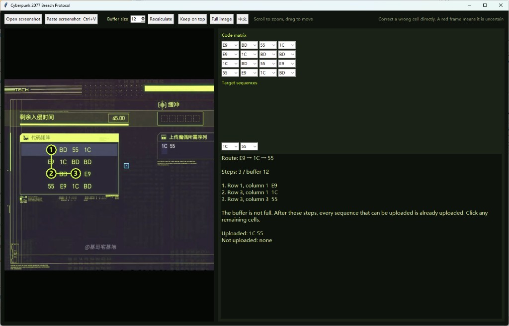

# 赛博朋克 2077 入侵协议

[English](README.en.md)

本地小工具：把《赛博朋克 2077》入侵协议的截图贴进来，读出代码矩阵、目标序列和缓冲区长度，并标出一条上传路线。

程序只分析你自己打开或粘贴的图片。它不读取游戏内存，不自动点击，运行时也不联网。

由 [Cyberpunk_CodeMatrix_decipher](https://github.com/zlmturnout/Cyberpunk_CodeMatrix_decipher) 迭代而来。原项目要手填矩阵再穷举路线。这一版直接读截图。路线规则仍来自原项目，许可协议沿用 MIT，见 `LICENSE`。



## 它做什么

入侵协议里有一块方形代码矩阵，右侧有一到三条要上传的序列，上方有一排缓冲区空格。你要从第一行选一格开始，之后在同一行和同一列之间交替点选，已经点过的格子不能再点。缓冲区走满，或者你主动结束时，路径里连续出现的序列会被上传。

这个程序会：

- 从截图里找出代码矩阵。边长不写死，4×4 到 7×7 都可以。
- 读出矩阵右侧的目标序列。每条一般是 2 到 4 个代码。
- 数上方缓冲区有几格。数不清时先按 8 格，并提示你核对。
- 算出一条路线，在截图上标 1、2、3…，右侧写出每一格的行列。

游戏里的代码只有六种：`1C`、`55`、`7A`、`BD`、`E9`、`FF`。识别靠这六种黄色等宽字形，不靠中文 OCR。字形模板在 `templates.npz` 里。认错的格子会用红框标出，下拉框里可以直接改，改完会重新计算。

## 怎样算一条好路线

同时满足这些规则：

1. 完成的序列越多越好。
2. 条数一样时，优先更长的序列。
3. 再优先更短的路径，少留后面点错的机会。

序列按路径上的连续代码匹配，前后可以接在一起，也可以重叠。缓冲放不下全部序列时，结果里会分开写已上传和未上传。矩阵是方形、缓冲不超过十几格时可以搜完，结果是确定的。

## 怎么用

需要 Python 3，以及 `numpy`、`pillow`。界面用系统自带的 tkinter。

```bat
python -m pip install -r requirements.txt
```

安装依赖时 pip 会联网下载一次。装好之后，双击 `启动.bat`，或在这个目录执行 `python app.py`，运行过程本身不需要网络。

1. 用系统截图或截图软件复制入侵协议画面，回到窗口按 Ctrl+V。也可以点「打开截图」选一张已保存的图片。
2. 左侧会先对准代码矩阵。滚轮以鼠标位置放大缩小，按住左键拖动，点「完整图」回到整张截图。
3. 右侧核对矩阵、序列和缓冲格数。红框表示这一格不太稳。
4. 按右侧列出的行、列依次点击。缓冲没走满时，列出的步骤走完就可以随便点剩下的格子。

工具栏上的 **English** 把界面换成英文，英文界面里的 **中文** 再换回来。截图上的步骤编号和代码本身不变。

**窗口置顶** 让这个窗口留在游戏前面，再点一次取消。

## 文件

| 文件 | 作用 |
| --- | --- |
| `app.py` | 窗口：打开或粘贴截图、改格子、画路线、切换语言 |
| `recognize.py` | 从截图读出矩阵、序列、缓冲格数和每格置信度 |
| `solver.py` | 按入侵协议规则搜索路线 |
| `templates.npz` | 六种代码的字形模板 |
| `启动.bat` | Windows 下双击启动 |
| `requirements.txt` | Python 依赖 |
